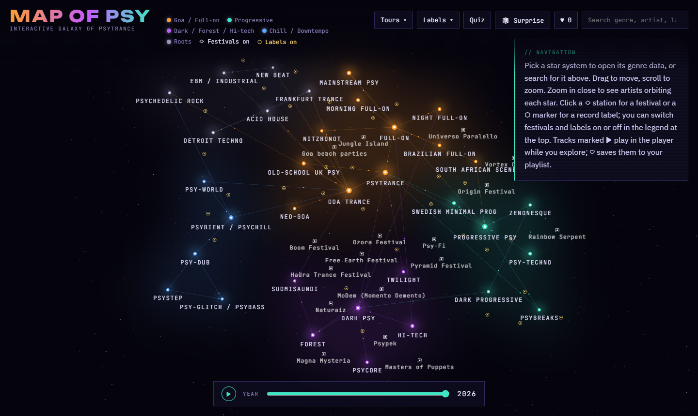
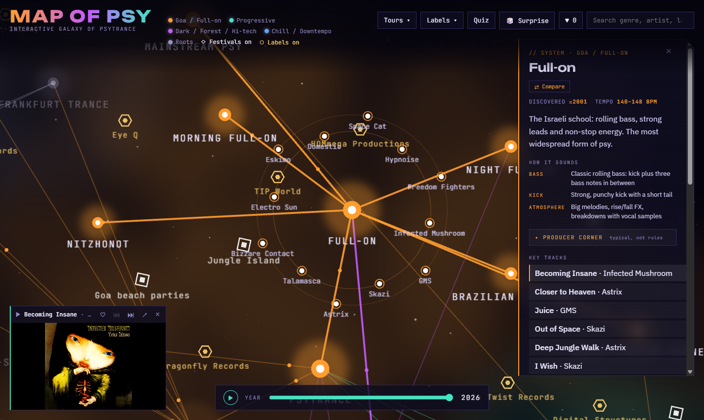
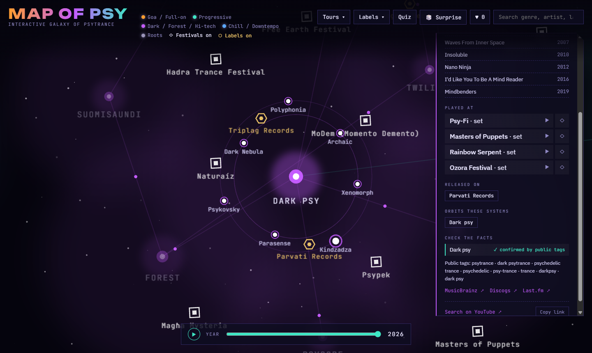
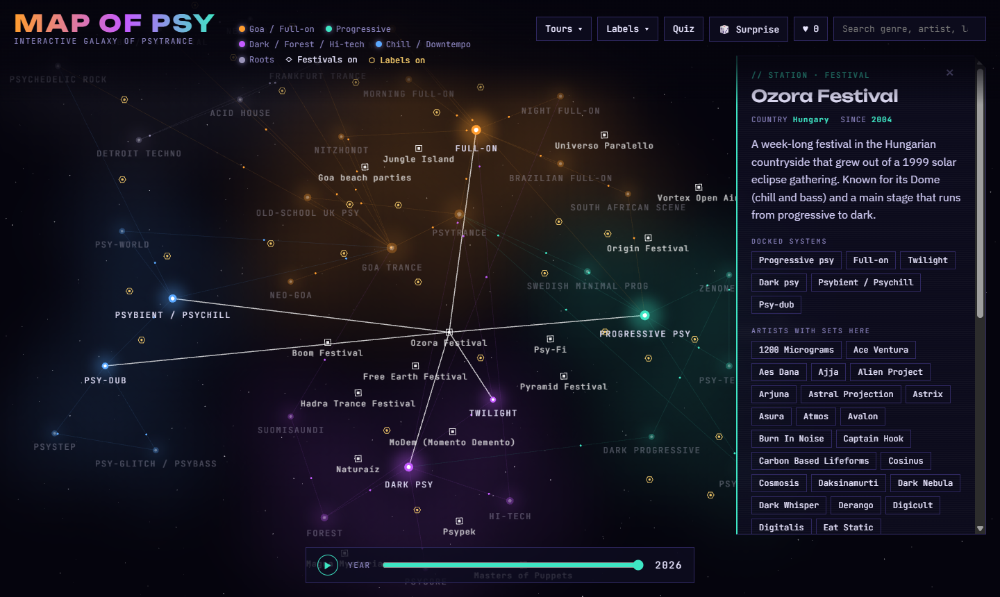
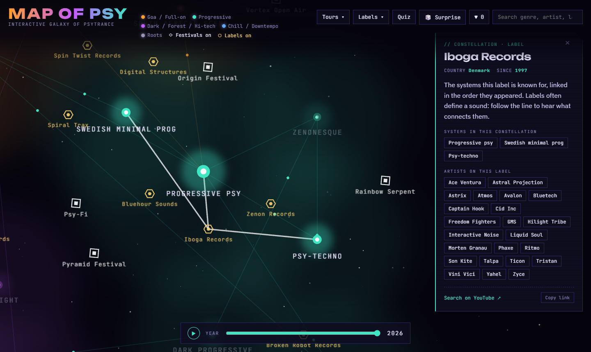
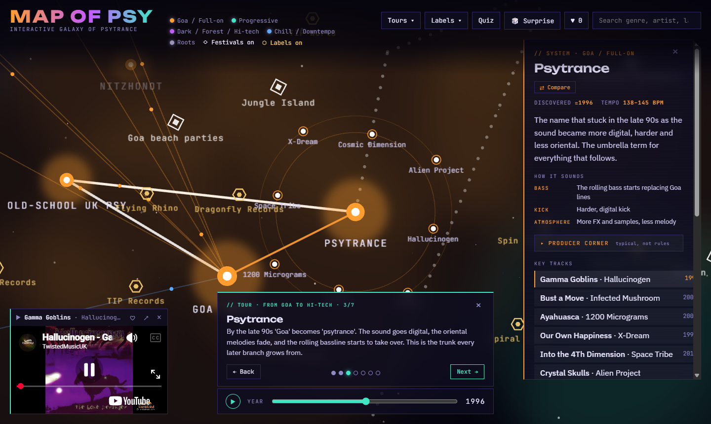
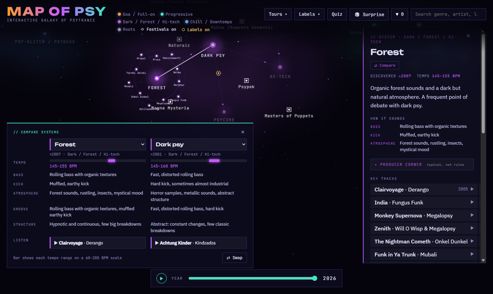
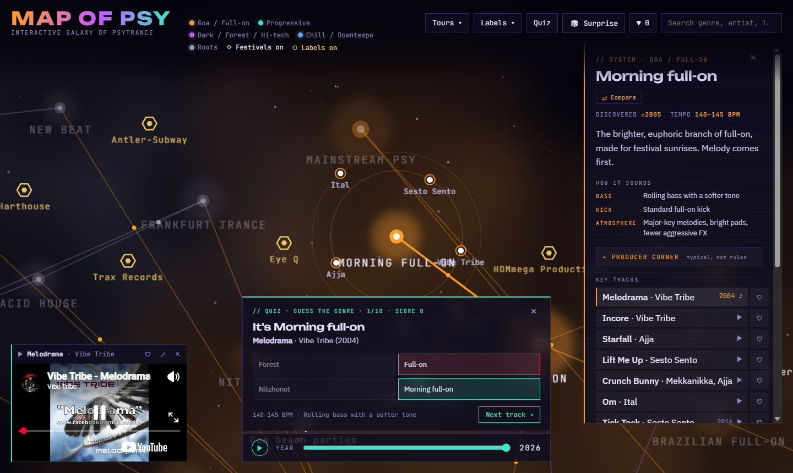
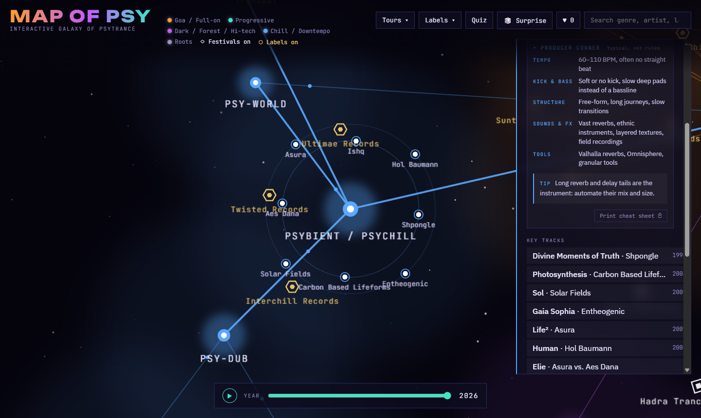
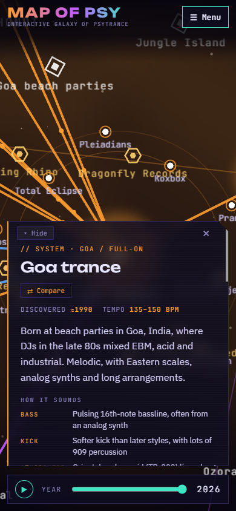

# Map of Psy · interactive galaxy of psytrance

An interactive star map of psytrance, inspired by [Map of Metal](https://mapofmetal.com). Every genre is a star system,
from the roots (psychedelic rock, EBM, acid house, Detroit techno) through Goa, full-on and progressive to darkpsy,
hi-tech and psycore. Artists orbit the stars as satellites, festivals are stations and record labels are markers,
and almost every star comes with key tracks you can play while you explore.

**Live site: [map-of-psy.vercel.app](https://map-of-psy.vercel.app)**





## Features

- **Star map.** 35 genres in five scenes (Roots, Goa / Full-on, Progressive, Dark / Forest / Hi-tech, Chill / Downtempo),
  connected by routes that show which genre grew out of which. Stars pulse at the tempo of their genre. Drag to move,
  scroll or pinch to zoom; up close, the artists of each genre orbit the star as satellites.
- **Genre HUD.** Description, how it sounds (bass, kick, atmosphere), key tracks with year, artists, labels, scene,
  festivals and the genres it evolved from and influenced.
- **Producer corner.** For every psy genre: typical tempo, kick and bass pattern, arrangement in bars, sounds and FX,
  tools (including FL Studio plugins) and one studio tip, plus a printable one-page cheat sheet.
- **Artist profiles.** Country, albums, tracks on the map, the festivals they played (with a ▶ to play the set),
  the labels they released on, and a **Check the facts** block: whether public genre tags confirm the placement,
  plus links to MusicBrainz, Discogs and Last.fm.
- **Player and playlist.** A mini YouTube player keeps playing while you move around. ♡ saves a track to your
  playlist (stored in the browser); a genre's track list or the playlist plays through on its own, with ⏮ ⏭.
- **Festivals and labels on the map.** 17 festival stations (Boom, Ozora, Universo Paralello, Masters of Puppets,
  MoDem, Pyramid, Psypek…) and 30 record labels (Iboga, TIP, Dragonfly, Parvati, Zenon, Suntrip…). Clicking one draws
  lines to the genres it is known for. Both layers can be switched on and off in the legend.
- **Guided tours.** Five tours, for example *From Goa to Hi-tech* or *The roots of psy*: the camera flies from star to
  star, the year slider moves forward and each stop plays a track with a short story.
- **Guess the genre.** A 10-round quiz: a mystery track plays with the title hidden and you pick its genre.
  The first game uses well-known classics, later games draw from the whole map.
- **Compare.** Two genres side by side: tempo bar, bass, kick, atmosphere, groove, structure and one track from each.
- **Time machine.** ▶ next to the year slider plays history from 1965 to today, lighting each star as its genre appears.
- **Search and sharing.** Search genres, artists, labels, festivals and tracks. The address bar always describes the
  current view, so any system, artist, festival or label can be shared as a link.
- **Phones and tablets.** A compact header with a menu, and the HUD as a bottom sheet that can be folded away.

| | |
|---|---|
|  |  |
|  |  |
|  |  |
|  |  |

## Tech stack

- **React 18** with **TypeScript** and **Vite**
- **PixiJS 8** (WebGL) for the map, **pixi-viewport** for the camera
- **YouTube IFrame Player API** for the player
- Plain CSS, no UI framework
- Hosted on **Vercel**

## Getting started

```bash
npm install
npm run dev
```

Then open `http://localhost:5173`.

| Script | What it does |
|---|---|
| `npm run dev` | Start the dev server with hot reload |
| `npm run build` | Type-check and build the site into `dist/` |
| `npm run preview` | Serve the production build locally |
| `npm run lint` | Run ESLint |

### Deployment

The live site is on [Vercel](https://vercel.com), which rebuilds it on every push to `main`
(framework preset Vite, build command `npm run build`, output `dist`).
Link previews (Facebook, Viber, WhatsApp…) need the site's public address, set in `.env` as
`VITE_SITE_URL=https://map-of-psy.vercel.app`; change it if the domain changes.

## Project structure

```
src/
├── data/         # All content as JSON (see below) + types.ts with the types and helper lookups
├── galaxy/       # Galaxy.tsx: the PixiJS scene (stars, routes, satellites, stations, label markers, camera)
├── components/   # Panel (HUD), Player, Search, Tours, Quiz, Compare, Playlist, LabelsMenu, ProducerCorner
├── hooks/        # usePlaylist (saved tracks in localStorage)
└── App.tsx       # Layout, app state and the shareable-URL sync
public/           # favicon, og-image.png (link preview), robots.txt
docs/screenshots/ # Images used in this README
```

### Data

Everything you see on the map lives in `src/data/` as JSON, so content can be edited without touching code:

| File | Content |
|---|---|
| `genres.json` | Genres, scenes and colors, influence links, star positions, key tracks, artists, labels |
| `artists.json` | Artist profiles: country, active since, albums |
| `appearances.json` | Festival sets per artist (YouTube video of the set, or a published line-up) |
| `festivals.json` | Festival stations: country, first edition, genres, position |
| `labels.json` | Record labels: country, founded, artists, marker position |
| `sources.json` | Per artist: MusicBrainz / Discogs / Last.fm links, public genre tags, placement check |
| `tours.json` | Guided tours: each stop is a genre, a short text and a track |
| `producer.json` | Producer corner notes per genre |

### How the map works

The map is one PixiJS scene inside a pixi-viewport camera. Stars, routes, satellites, stations and label markers are
drawn once at start-up; React only tells the scene what is selected, which year it is and what to highlight, and an
effect updates visibility, alpha and lines. A single ticker animates everything else: the halo of each star pulses
once per bar at its genre's BPM, particles travel along the routes, satellites orbit and stations rotate.
Text labels are scaled against the zoom level so they stay readable when zoomed out, and label names are hidden when
they would collide with satellites.

The player uses the YouTube IFrame API rather than a plain embed, so it knows when a video ends and can move on to
the next track in the queue. In the quiz the same player keeps playing behind a cover so the title stays hidden.

## Data sources

- Releases, artist profiles and labels: [MusicBrainz](https://musicbrainz.org) and [Discogs](https://www.discogs.com)
- Genre tags: MusicBrainz and [Last.fm](https://www.last.fm)
- Tracks and festival sets: [YouTube](https://www.youtube.com)
- Festival and label details: festival and label sites, Bandcamp, Wikipedia

How the data was cross-checked, and what was corrected, is in [`verification-report.md`](verification-report.md).
